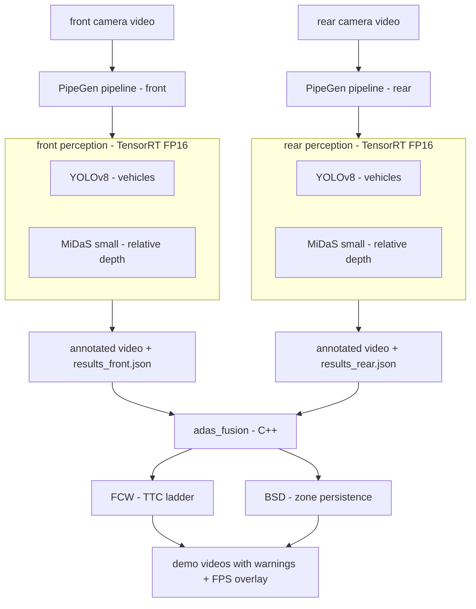
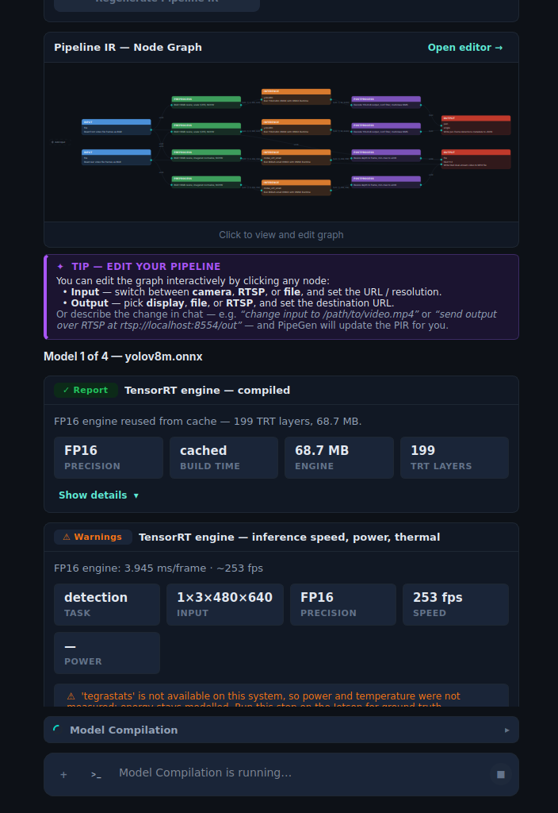

# Mini-ADAS — FCW + BSD Stack Built with PipeGen

> Lightweight L2 driver-assist prototype: **Forward Collision Warning** (front camera) and
> **Blind Spot Detection** (rear camera) from plain video files — real-time TensorRT **FP16**
> perception generated with [CraftifAI PipeGen](https://developer.craftifai.com) .

## Demo

All demo videos live in [`demos/`](demos/) with live FPS overlays and warning banners burned in:

| File                                                     | Shows                                                                     |
| -------------------------------------------------------- | ------------------------------------------------------------------------- |                     |
| [`demos/front-cam.mp4`](demos/front-cam.mp4)             | FCW on dashcam front view — lead-vehicle tracking, range + TTC ladder     |
| [`demos/rear-cam.mp4`](demos/rear-cam.mp4)               | BSD blind-spot zones on rear view — persistence-gated left/right warnings |

One command reproduces the side-by-side demo (see [Quick start](#quick-start)):

```bash
./run_demo.sh                            # uses the bundled front/rear clips
./run_demo.sh my_front.mp4 my_rear.mp4   # or your own clips
```

## What it does

- **FCW (front):** tracks the lead vehicle in the ego corridor, estimates range by
  fusing MiDaS relative depth with a bbox-pinhole anchor, derives TTC from the
  closing rate, and raises `WARN` / `CRITICAL` banners on a TTC ladder.
- **BSD (rear):** watches trapezoidal blind-spot zones on the rear view; a vehicle
  that persists inside a zone for N frames raises a left/right warning (with leaky
  decay so flicker doesn't latch).
- Every output frame carries detection boxes + depth labels, warning banners, and a
  live **FPS** readout.

## Architecture



**Data flow in words:** video → TensorRT FP16 perception (boxes + per-object
relative depth → `results_*.json` + annotated video) → `adas_fusion` (C++) fuses
depth into metric range, runs FCW/BSD logic, re-renders the demo video.

## How it works

### 1. Perception (PipeGen, TensorRT FP16)

`pipelines/perception.py` runs two FP16 engines per frame inside the PipeGen
container (polygraphy + TensorRT):

- **YOLOv8** — vehicle classes (`car`, `bus`, `truck`, `motorcycle`, `bicycle`,
  `person`), conf ≥ 0.35, NMS IoU 0.45, letterboxed input.
- **MiDaS small** — dense relative inverse depth (higher = closer), resized back
  to frame size and normalized to 0…1 per frame; the median over each bbox becomes
  that object's `depth` value in JSON.

Output per frame (`results_*.json`): `{ label, confidence, bbox[x,y,w,h], depth }`
plus `frame`, `pts_ns`, `width`, `height` — the exact schema `adas_fusion` consumes.

### 2. Decision layer (`adas/`, C++17 + OpenCV + nlohmann-json)

| Function | Trigger                             | Defaults                                                                                         |
| -------- | ----------------------------------- | ------------------------------------------------------------------------------------------------ |
| FCW      | TTC to lead vehicle below ladder    | warn **3.2 s**, critical **2.3 s**, range ≤ **40 m**, **2 s** cooldown                           |
| BSD      | vehicle persists in blind-spot zone | critical **2.5 × 5 m** / overtake **8 × 5 m** equivalents, **10-frame** persistence, leaky decay |

**Range estimation (monocular fusion):** per frame,
`scale = median(pinhole_i / midas_i)` over detected vehicles, then
`range_i = scale · pinhole_i`-style anchoring — i.e. MiDaS supplies relative
structure, the bbox pinhole model (`f ≈ 0.9 · width`, `H ≈ 1.5 m`) supplies
absolute scale. TTC comes from the filtered closing rate of the in-corridor lead
target at an assumed 60 km/h cruise (no CAN feed).

## Models

All engines are TensorRT **FP16**, chosen for speed. Compiled on an
**rtx 3050 Laptop (Blackwell, sm_120)** with **TensorRT 10.8**.

| Task                             | Model            | Engine                            | Source                    |
| -------------------------------- | ---------------- | --------------------------------- | ------------------------- |
| Vehicle detection (front + rear) | YOLOv8-m (ONNX)  | `yolov8m.fp16.engine`, ~55 MB     | PipeGen benchmark catalog |
| Monocular depth (front + rear)   | MiDaS v2.1 small | `midas_small.fp16.engine`, ~36 MB | PipeGen benchmark catalog |

> Engines (`*.engine`), source clips (`*.mov` / `*.mp4` inputs), and downloads are
> git-ignored — only `demos/*.mp4` and the PipeGen session records are committed.
> Rebuild engines via PipeGen or reuse your own; see
> [`pipegen_session/model_stage/`](pipegen_session/model_stage/) for the build reports.

## Project structure

```text
.
├── adas/                   # adas_fusion — C++17 decision layer (FCW/BSD, render)
│   ├── CMakeLists.txt
│   └── src/adas_fusion.cpp # --mode front|rear --video --json --out
├── pipelines/              # perception runner + engines + JSON outputs
│   ├── perception.py       # FP16 runner (polygraphy): video → annotated mp4 + results.json
│   ├── engines/            # yolov8m + midas_small .engine files (git-ignored)
│   └── out_pipegen/        # results_front.json / results_rear.json, run logs
├── demos/                  # committed demo outputs (front, rear, side-by-side)
├── pipegen_session/        # verbatim PipeGen session: requirements, PIR, reports
├── assets/                 # README images (PipeGen FP16 compilation screenshot)
├── videos/                 # download.sh for test clips (yt-dlp + ffmpeg)
├── thirdparty/clrnet/      # unused lane-net reference (not in build)
├── run_demo.sh             # end-to-end: perception → fusion → side-by-side → play
└── docs/watch_shots.sh     # PipeGen window screenshot helper
```

## Quick start

### Prerequisites

| Need             | Version / notes                                                            |
| ---------------- | -------------------------------------------------------------------------- |
| GPU + driver     | NVIDIA GPU; tested on rtx 3050 Laptop (sm_120)                             |
| Docker           | `craftifai-amd64-v3` (DeepStream 7.1, TRT 10.8 — see note below)           |
| Host build       | CMake ≥ 3.16, C++17, OpenCV, nlohmann-json                                 |
| Host video tools | `ffmpeg`, `ffplay` (side-by-side stitch + playback)                        |
| Input clips      | `front.mov` / `rear.mov` (or any dashcam `.mp4`; see `videos/download.sh`) |

Note: stock DeepStream 7.1 ships TensorRT 10.3, which fails on Blackwell (sm_120)
with `Unsupported SM: 0xc00`; the image used here was upgraded to TensorRT 10.8.

```bash
# C++ decision layer (once)
cmake -S adas -B adas/build && cmake --build adas/build
```

### Option A — one command (recommended)

```bash
./run_demo.sh                            # defaults to $HOME/personal/pipegen/front.mov + rear.mov
./run_demo.sh my_front.mp4 my_rear.mp4   # or pass your own clips
```


### Option B — manual steps

All paths relative to the repo root:

```bash
# 0. build once (see above)
cmake -S adas -B adas/build && cmake --build adas/build

# 1. perception — FP16 engines (YOLOv8 + MiDaS) in the container.
#    Produces annotated video + per-frame JSON per camera.
YE=pipelines/engines/yolov8m.fp16.engine
ME=pipelines/engines/midas_small.fp16.engine
mkdir -p pipelines/out_pipegen demos

docker exec craftifai-amd64-v3 bash -c \
  "cd $PWD/pipelines && python3 perception.py <front.mov> out_pipegen/results_front.mp4 out_pipegen/results_front.json $YE $ME"
docker exec craftifai-amd64-v3 bash -c \
  "cd $PWD/pipelines && python3 perception.py <rear.mov> out_pipegen/results_rear.mp4 out_pipegen/results_rear.json $YE $ME"

# 2. decision layer + demo render (host)
./adas/build/adas_fusion --mode front --video <front.mov> \
  --json pipelines/out_pipegen/results_front.json --out demos/front-cam.mp4
./adas/build/adas_fusion --mode rear --video <rear.mov> \
  --json pipelines/out_pipegen/results_rear.json --out demos/rear-cam.mp4


```

`adas_fusion` also tolerates truncated JSON (recovers at the last intact frame)
so a killed perception run still renders.

## Built with PipeGen

The exact prompt given to PipeGen:

> I am building a lightweight L2 ADAS perception stack for a dual-camera
> vehicle setup, running real-time on edge hardware. Inputs: two video files,
> front camera front.mov and rear camera rear.mov, no physical cameras. Tasks:
> vehicle detection and monocular depth estimation on both cameras as
> independent parallel tasks. Use the lightest and fastest benchmark models
> available: the compact YOLOv8 ONNX repo for vehicles and MiDaS small for
> depth. Compile every engine in FP16. Outputs: no live display window — write
> the processed annotated video to a file, and also write every detection to
> JSON with per-frame objects including class, confidence, bounding box,
> per-object depth value, so a downstream module can compute FCW and BSD.
> Any scene condition is possible including night and rain.

PipeGen compiling the models to **FP16 TensorRT** engines:



The full session — requirement conversation, repo/source selection, PIR, and the
FP16 compilation reports — is committed verbatim under
[`pipegen_session/`](pipegen_session/):

- `RequirementState.json`, `PipelineIR.json`, `RepoGate.json`, `state.json`
- `model_stage/` — per-model build reports (`yolov8m`, `midas_v21_small`, …)

## What was built on top of PipeGen

- `adas/` — **adas_fusion** (C++17, OpenCV + nlohmann-json): FCW TTC ladder +
  BSD zone-persistence logic, monocular range fusion, warning banners, FPS overlay.
- `pipelines/perception.py` — TensorRT FP16 runner (polygraphy) mirroring the
  PipeGen pipeline output schema; used to iterate while the PipeGen session
  compiled. Produces identical `results.json` + annotated video.
- Blackwell (sm_120) container fix: TensorRT 10.3 → **10.8** upgrade of the
  DeepStream 7.1 image (stock image fails with `Unsupported SM: 0xc00`).

## Limitations & next steps

- **Monocular range is approximate** — pinhole-anchored MiDaS drifts with pitch,
  night/rain, and off-size vehicles; a calibrated camera + ego-speed (CAN) feed
  would tighten TTC.
- **No tracking yet** — FCW picks the in-corridor lead per frame; a Kalman/IoU
  tracker + lane mask would stabilize warnings.
- **BSD zones are image-space trapezoids**, not calibrated meters; fine-tune
  `bsd_critical_l_m` / `bsd_overtake_l_m` / persistence per mount.
- `thirdparty/clrnet` (lane net) is vendored but **not wired in** — natural next
  step is LDW/ACC on top of the same JSON schema.
